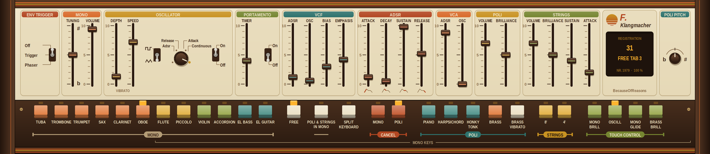

# F. Klangmacher

VST3-Instrument von **BecauseOfReasons**.

F. Klangmacher ist ein Kombi-Keyboard aus drei Instrumenten, die gleichzeitig spielen: **Poli**, **Strings** und ein monophoner **Mono-Synthesizer**. Klanglich ist es kein moderner Synth, sondern eine schaltungsnahe Emulation eines analogen Geräts von 1979, mit all seinen Eigenheiten.

### Die drei Teile

**Poli**: voll polyphon über alle 61 Tasten (Teilergenerator, jede Taste klingt). Zwei Familien:
* *Piano, Harpsichord, Honky Tonk*: perkussiv, mit Abklingen je Taste. Honky Tonk ist nicht verstimmt, sondern ein gegenphasig beigemischter Harpsichord-Anteil.
* *Brass, Brass Vibrato*: Sägezahn durch ein Filter mit gemeinsamer Hüllkurve (paraphon: alle Tasten teilen sich Filter und Hüllkurve).

**Strings**: 8' und 4', Ensemble-Chorus aus drei Eimerkettenspeichern, Regler für Attack, Sustain und Brilliance.

**Mono**: ein vollständiger monophoner Synthesizer mit eigenem 4-poligem Filter (mit Emphasis), VCA, ADSR, LFO und Portamento. Die höchste gedrückte Taste hat Vorrang. Zwölf feste Klangfarben (Tuba bis El. Guitar) bringen eigene Filter- und Hüllkurveneinstellungen mit. Mit **FREE** gelten stattdessen die Regler auf dem Panel.

### Tastatur und das Links-rechts-Stereo

* Mono spielt erst ab dem zweiten C (MIDI-Note 48), Poli und Strings über die ganze Tastatur (36–96).
* **SPLIT KEYBOARD**: Poli und Strings links (36–64), Mono rechts (ab 65). So spielst du Begleitung und Solo mit zwei Händen.
* **Ausgang wie beim Original:** **links Poli + Strings, rechts Mono.** Das ist kein Panorama-Effekt: Das Gerät hatte zwei getrennte Ausgangsbuchsen. In der DAW kannst du die Teile damit getrennt bearbeiten, z. B. den Kanal aufteilen und nur dem Mono-Synth ein Delay geben. Wer ein normales Stereo-Signal will, stellt im Menü (Klick auf das Display) auf **Mono-Summe**.
* **POLI & STRINGS IN MONO** schickt Poli und Strings zusätzlich durch Filter und VCA des Mono-Synths, also mit dessen Hüllkurve. Das ergibt Filter-Sweeps über Akkorde.

### Spielhilfen

* **Touch Control** = zweiter Druckpunkt der Tasten, hier per **Aftertouch** oder **Modrad**: *Mono Brill* öffnet das Filter, *Oscill* bringt das Vibrato erst bei Druck, *Mono Glide* zieht den Ton um bis zu zwei Halbtöne hoch, *Brass Brill* öffnet das Brass-Filter. Vorsicht: In vielen Werksklängen ist *Oscill* aktiv, dann kommt das Vibrato nur mit Aftertouch oder Modrad.
* **CC 11** Schwellerpedal, **CC 64** Sustain (Piano, Harpsichord, Honky Tonk), **CC 7** Lautstärke.
* **E.F.T.**: Sidechain-Eingang. Ein externes Signal (z. B. Gitarre oder Drums) startet die Hüllkurve des Mono-Synths oder läuft durch dessen Filter.

### Sonst noch

* 40 Werksklänge, alle Regler automatisierbar, Zustand wird im Projekt gespeichert.
* **Bauteilstreuung**: Jedes „Gerät“ hat leicht eigene Bauteilwerte, abgeglichen auf wenige Cent. Im Menü lässt sich ein anderes Gerät würfeln oder auf ideale Bauteile schalten.
* Fenstergröße 75 / 100 / 150 / 200 % (Rechtsklick aufs Panel).

### Download und Bauen

* Fertige Plugins für Windows (32/64 Bit) und Linux: unter **[Releases](../../releases)**
* macOS, Bauen aus dem Quellcode und Tests: [vst3/README.md](vst3/README.md)
