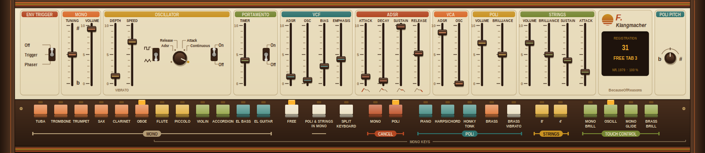

# F. Klangmacher – VST3-Instrument von BecauseOfReasons

Schaltungsnahe Emulation eines analogen Kombi-Keyboards von 1979 (Poli, Strings, Mono-Synthesizer), gebaut direkt
auf dem Steinberg VST3 SDK (ohne JUCE) mit eigener VSTGUI-Oberfläche im 70er-Stil. Grundlage des Klangmodells ist
das Service-Manual des Originalinstruments (in `../res/`, nur zur Entwicklung, siehe „Rechtliches“):
Schaltpläne, Funktionsbeschreibung, Abgleichanweisungen und die 40 Registrierungen.



## Installieren

| System | Datei | Ziel |
|---|---|---|
| Windows 64 Bit (Ableton & Co.) | `dist/FKlangmacher.vst3` (ganzer Ordner) | `C:\Program Files\Common Files\VST3\` |
| Windows 32 Bit (alte DAWs) | derselbe Ordner | `C:\Program Files (x86)\Common Files\VST3\` (32-Bit-Host auf 64-Bit-Windows) bzw. `C:\Program Files\Common Files\VST3\` (32-Bit-Windows) |
| Linux 64 Bit | `dist/linux/FKlangmacher.vst3` | `~/.vst3/` |
| macOS | wird auf einem Mac gebaut, siehe „macOS bauen“ | `~/Library/Audio/Plug-Ins/VST3/` |

Der Windows-Ordner enthält beide Varianten (`Contents/x86_64-win` und `Contents/x86-win`); jeder Host nimmt sich die
passende.

Ableton vorher schließen (oder Plugins neu scannen). Das Plugin erscheint als Instrument „F. Klangmacher“
(Hersteller BecauseOfReasons).

## Was es kann

* **Komplettes Bedienfeld ohne Klaviatur** in eigenem Design (cremefarbenes Panel, Funktionsgruppen als Kacheln,
  Skalen 0–10, Rallyestreifen): 21 Schieberegler, Drehschalter OSCILLATOR, POLI PITCH, Kippschalter, 27 Registertasten
  mit Lampen. Jedes Element ist ein automatisierbarer DAW-Parameter
  (44 Parameter plus Registrierungswahl).
* **Größe 75 / 100 / 150 / 200 %**: Klick auf das Display im Namensschild oder Rechtsklick
  irgendwo aufs Panel → „Größe …“. Die Größe wird mit dem Projekt gespeichert und gilt zugleich als Vorgabe für neue
  Instanzen (`%APPDATA%\FKlangmacher\settings.txt` bzw. `~/.config/FKlangmacher/settings.txt`). Die Windows-
  Anzeigeskalierung (HiDPI) kommt vom Host dazu. Bei 100 % ist das Fenster 1600 × 348 Pixel groß.
* **Zustand** wird mit dem Projekt gespeichert (alle Parameter, Registrierung, Gerätenummer).
* **40 Werksregistrierungen** aus dem Manual als Programmliste. Wahl über die DAW oder durch Klick auf das Display
  im Namensschild; dort auch Gerätewahl und Ausgangsmodus.
* **Ausgang** wie die Buchsen des Originals: links Poli + Strings, rechts Mono. Umschaltbar auf Mono-Summe.
* **E.F.T.-Eingang** (Envelope Follower Trigger) als Sidechain-Eingang „E.F.T. In“. Schalter ENV TRIGGER:
  *Off* – aus; *Trigger* – das externe Signal läuft durch VCF/VCA und jeder Einsatz startet die Hüllkurve;
  *Phaser* – Hüllkurve dauerhaft offen, das externe Signal läuft durch das Filter (mit VCF-OSC ein Wah-Effekt).
  Empfindlichkeit: Parameter „E.F.T. Sensitivity“.
* **Bauteilstreuung**: Jedes „Gerät“ (Nummer = Startwert, Standard 1979) hat eigene Toleranzen in Tastungs-
  kondensatoren, Filtern, Hüllkurven, LFO und Ensemble. Es ist **vom Techniker abgeglichen**: Poli ±1,5 Cent,
  Mono ±2,5 Cent Restfehler (Teiler-Rundung der Generatoren kommt dazu, wie beim Original ≈ ±1 Cent).
  „Ideale Bauteile“ schaltet die Streuung ab.

### MIDI

| MIDI | Funktion |
|---|---|
| Noten 36–96 | die 61 Tasten (C2–C7). Mono spielt ab dem 2. C (Note 48), mit SPLIT Poli auf Note 36–64, Mono ab 65 |
| Aftertouch (Kanal und polyphon), CC 1 | **zweiter Druckpunkt** (Fotozelle unter den Tasten): Touch-Control MONO BRILL, OSCILL, MONO GLIDE, BRASS BRILL |
| CC 11 | **Schwellerpedal** (wirkt wie beim Original auf beide Kanäle, ca. 24 dB Bereich) |
| CC 64 | **Sustain-Schalter** am Schweller (Piano / Harpsichord / Honky Tonk) |
| CC 7 | Ausgangspegel |

Hinweis: In vielen Registrierungen ist der Touch-Tab **OSCILL** gedrückt. Dann kommt das Vibrato – wie am Original –
erst mit dem zweiten Druckpunkt (Aftertouch oder Modrad).

## Wie das Klangmodell aufgebaut ist

Alle Werte stammen aus den Schaltplänen; die Auswertungen liegen in `docs/schaltungsanalyse/` (A–D).

**Poli** (`src/core/poly.cpp`)
* 2-MHz-Takt → TOS AY-1-0212 (echte Teiler 478 … 902) → binäre Teiler, phasenstarr wie im Gerät.
* Piano/Harpsichord/Honky Tonk: Perkussions-Tastung PA 867 mit der Schwellen-Gleichung des Multi-Emitter-
  Transistors: Es klingt nur, solange alle 4/3/2 gemischten Fußlagen gleichzeitig „low“ sind → schmaler Impuls
  (1/16, 1/8, 1/4). Hüllkurve mit 2,2 µF (+10 µF bei gehaltener Taste), SM-Abgriffen je Tastenbereich und
  Sustain-Schalter. Klangfarben nur durch die Vorfilter je Oktav-Strang (P1–P5); Honky Tonk = Piano plus
  gegenphasiger, abgeschwächter Harpsichord-Zweig (keine Verstimmung, so steht es im Plan).
* Brass und Strings: Sägezahn durch „negative Detektion“ der Rechtecke (Kondensator je Note, τ = 16,5 kΩ·C),
  Tastung über die Multi-Emitter-Gleichung mit Basisspannung (Register an/aus, verzögerter Strings-Attack).
* Poli-VCF (2 × OTA-Sallen-Key, Q 0,745) mit statischer Brillanz bzw. paraphoner Brass-Hüllkurve (IC2/IC3).
* Strings: Strang-Bandpässe, Ensemble mit drei TDA1022 (0,6 Hz + 6 Hz, 120° versetzt, 3,4–5,1 ms, 100 % nass),
  danach IC24 (Brillanz = Güte), C.S.-Sustain paraphon (lange Ausklingzeit erst, wenn alle Tasten los sind).
* Brass Vibrato: 6-Hz-Oszillator der Delay-Platine moduliert den Poli-Takt.

**Mono** (`src/core/mono.cpp`)
* M110: höchste Taste hat Vorrang, jede neue Vorrang-Taste startet die Hüllkurve neu (C.RIP, 4 ms).
  Portamento in Halbtonschritten (Abtastung des M110), TIMER bestimmt die Schrittzeit.
* Sägezahn 0…4 V mit konstanter Amplitude, Fußlagen 32'/16'/8'/4' je Register (aus der Diodenmatrix).
* 12 Klangfarben mit den Formern und Vorfiltern aus DWG 8 (Hochpässe, Schmitt-Trigger für Sax/Oboe,
  Dreieck→Sinus für Flöte, Akkordeon aus 3 Rechteck-Fußlagen + bewegtem Puls, Violin-Diodenhochpass,
  El. Bass mit Anschlags-Pulsbreite und Bandpass, El. Guitar mit OTA-Hochpass-Sweep).
* ADSR (3,3 µF) mit den Preset-Netzwerken je Register (inkl. Doppel-Decay für El. Bass/Guitar) bzw. den
  Panel-Reglern bei FREE.
* VCF: 4-polig (2 × OTA-Sallen-Key), Emphasis bis knapp vor Selbstschwingung, exponentieller Steuerteil,
  lineare Tastaturverfolgung über VK. VCA linear (Diodenvorverzerrung) mit exponentiellem Treiber.
* LFO 0,3–83 Hz mit Ein-/Ausblendschaltung, Betriebsarten Adsr / Release / Attack / Continuous.

## Annahmen (nicht im Manual, bewusst gewählt)

| Punkt | Wahl | Grund |
|---|---|---|
| Steilheit des Poli-VCF-Treibers | 0,55 V/Oktave | wörtlich ergibt der Plan ~21 mV/Oktave, damit wäre der Brillanz-Regler nur auf 10 % seines Wegs wirksam |
| Pegel des Clarinet-Rechtecks | 0,45 Vss | im Plan nicht angegeben, so ähnlich laut wie die anderen Register |
| Pegelverhältnis Poli / Strings / Mono | per Messung ausgeglichen | absolute Pegel stehen nicht in den Plänen |
| Portamento-Schrittweite | Halbtöne, 0,2–42 ms pro Schritt | der M110 ist nicht dokumentiert |
| Schweller-Bereich | 24 dB | TCA730-Kennlinie nicht im Manual |
| POLI PITCH / MONO TUNING | ±50 Cent | Bereich nicht angegeben |
| Vibrato-Tiefe | 30 Cent pro Volt (max. ±45 Cent) | Empfindlichkeit des Takt-Eingangs nur abgeschätzt |

Wer das Original hört oder Aufnahmen hat: diese Stellen sind die Kandidaten zum Nachstimmen.

## Bauen

Voraussetzungen (Linux): VST3 SDK 3.8 in `~/SDKs/vst3sdk` (oder `-DVST3_SDK_ROOT=...`), cmake ≥ 3.25, ninja, für Windows MinGW-w64 (`mingw-w64`), zum Testen Wine.

```bash
cmake -S vst3 -B ~/build/fklangmacher -G Ninja -DCMAKE_BUILD_TYPE=Release
cmake --build ~/build/fklangmacher
cmake -S vst3 -B ~/build/fklangmacher-win -G Ninja -DCMAKE_BUILD_TYPE=Release -DCMAKE_TOOLCHAIN_FILE=$PWD/vst3/cmake/mingw-w64.cmake
cmake --build ~/build/fklangmacher-win
x86_64-w64-mingw32-strip -o vst3/dist/FKlangmacher.vst3/Contents/x86_64-win/FKlangmacher.vst3 ~/build/fklangmacher-win/VST3/Release/FKlangmacher.vst3/Contents/x86_64-win/FKlangmacher.vst3
cmake -S vst3 -B ~/build/fklangmacher-win32 -G Ninja -DCMAKE_BUILD_TYPE=Release -DCMAKE_TOOLCHAIN_FILE=$PWD/vst3/cmake/mingw-w64-i686.cmake
cmake --build ~/build/fklangmacher-win32
i686-w64-mingw32-strip -o vst3/dist/FKlangmacher.vst3/Contents/x86-win/FKlangmacher.vst3 ~/build/fklangmacher-win32/VST3/Release/FKlangmacher.vst3/Contents/x86-win/FKlangmacher.vst3
```

Die 32-Bit-Version braucht SSE2 (jede CPU seit etwa 2003) und den Linker-Schalter `--kill-at` (steht in
`cmake/plugin.cmake`), sonst findet der Host die Einstiegsfunktion `GetPluginFactory` nicht.

## macOS bauen

Der Code ist für den Mac vorbereitet (Schrift Arial, Einstellungen unter `~/Library/Application Support`,
Denormal-Schutz für Apple Silicon), aber **noch nie auf einem Mac übersetzt worden**. Fehlermeldungen bitte melden.

Voraussetzungen: Xcode oder die Command Line Tools (`xcode-select --install`), Homebrew mit `cmake` und `ninja`,
das VST3 SDK (getestet mit 3.8.1) inklusive Untermodule:

```bash
brew install cmake ninja
git clone --recursive https://github.com/steinbergmedia/vst3sdk.git ~/SDKs/vst3sdk
```

Bauen (ein Plugin für Intel- und Apple-Silicon-Macs gemeinsam; der Steinberg-Validator läuft nach dem Bauen
automatisch mit):

```bash
cmake -S vst3 -B build-mac -G Ninja -DCMAKE_BUILD_TYPE=Release -DCMAKE_OSX_ARCHITECTURES="arm64;x86_64" -DCMAKE_OSX_DEPLOYMENT_TARGET=10.13 -DVST3_SDK_ROOT=$HOME/SDKs/vst3sdk
cmake --build build-mac
build-mac/smk_test
```

Ergebnis: `build-mac/VST3/Release/FKlangmacher.vst3`. `smk_test` prüft den Klangkern (am Ende muss
„alle Prüfungen ok“ stehen).

Zum Weitergeben muss das Bundle signiert und notarisiert werden (Apple-Entwicklerkonto nötig), sonst blockiert
macOS es nach dem Herunterladen:

```bash
codesign --force --deep --options runtime --timestamp --sign "Developer ID Application: NAME (TEAMID)" build-mac/VST3/Release/FKlangmacher.vst3
ditto -c -k --keepParent build-mac/VST3/Release/FKlangmacher.vst3 FKlangmacher-mac.zip
xcrun notarytool submit FKlangmacher-mac.zip --keychain-profile "PROFILNAME" --wait
xcrun stapler staple build-mac/VST3/Release/FKlangmacher.vst3
```

Ohne Entwicklerkonto (nur für den eigenen Rechner): `codesign --force --deep -s - <bundle>` und nach dem Kopieren
`xattr -dr com.apple.quarantine ~/Library/Audio/Plug-Ins/VST3/FKlangmacher.vst3`.

Hinweis: Logic Pro und GarageBand laden keine VST3-Plugins (nur Audio Units). Ableton, Bitwig, Reaper, Cubase
und Studio One laden das VST3.

Die Registrierungen werden aus `tools/registrations.json` erzeugt: `python3 vst3/tools/gen_presets.py`.

## Tests

| Test | Was er prüft |
|---|---|
| `~/build/fklangmacher/smk_test [wav-ordner]` | Tonhöhe aller 12 Mono-Register und der Poli-Teiler, Tastenumfang, Split, Spielhilfen (Portamento, Glide, E.F.T., Sustain, Vibrato), Bauteilstreuung, alle 40 Registrierungen (Pegel, keine Übersteuerung), Rechenzeit; schreibt optional je Registrierung eine WAV |
| `~/build/fklangmacher/bin/Release/smk_hosttest <FKlangmacher.vst3>` | lädt das Plugin wie eine DAW: Programmwahl, Noten, Tonhöhe, Kanalzuordnung, Rückmeldung, Zustand |
| `validator -e` | Steinberg-Validator (Linux und `validator.exe` unter Wine: 537/537) |
| `~/build/fklangmacher/bin/Release/smk_uishot <ordner>` | rendert die Oberfläche als PNG |

Stand der Prüfung: alle Tests grün unter Linux; unter Wine Kern-Test und Validator für Windows 64 und 32 Bit
grün, Editorfenster unter Linux und Wine (64 und 32 Bit) geöffnet und abfotografiert, Größenwechsel im offenen
Fenster unter Linux geprüft. macOS: nicht übersetzt (kein Mac vorhanden). Rechenzeit ≈ 8 % eines Kerns mit 12 gehaltenen Tasten (Strings + Piano + Mono).
**Nicht geprüft:** Klang gegen ein echtes Gerät (keine Aufnahmen vorhanden) und Betrieb in Ableton selbst.

## Aufbau

| Pfad | Inhalt |
|---|---|
| `src/core/` | Klangmodell ohne SDK: `params` (Parametertabelle), `presets` (+ `gen/presets.inc`), `device` (Toleranzen), `poly`, `mono`, `synth` (Tastenverteilung, Ausgang), `dsp.h` |
| `src/plugin/` | VST3: Processor, Controller (Parameter, Programmliste, MIDI-Zuordnung), Editor, Zustand |
| `src/gui/` | Panel in VSTGUI, nur über `PanelHost` mit dem Plugin verbunden |
| `test/` | Kern-Test, Host-Test, Oberflächen-Bild |
| `tools/` | Registrierungen (JSON) und Generator |
| `docs/schaltungsanalyse/` | Auswertung der Schaltpläne (Bauteilwerte, Zeitkonstanten, Schaltlogik) |

## Rechtliches (Stand der Umsetzung, keine Rechtsberatung)

* Plugin und Oberfläche verwenden **keine Namen, Logos oder Grafiken des Originalherstellers**. Name, Emblem,
  Farben, Skalen und Kachel-Gestaltung sind eigene Entwürfe; die Binärdateien enthalten keinen Hinweis auf das
  Original. Übernommen sind nur die Anordnung der Bedienelemente nach ihrer Funktion und allgemeine
  Funktionsbezeichnungen (VCF, ADSR, PIANO, TRUMPET …).
* Die 40 Registrierungen sind Einstellwerte mit beschreibenden Namen („Piano“, „Split Keyboard 2“ …).
* **Nicht weitergeben:** `../res/` (Service-Manual und Fotos sind urheberrechtlich geschützt) und
  `docs/schaltungsanalyse/` (nennt das Original). Zum Weitergeben ist nur der Ordner `dist/FKlangmacher.vst3`
  gedacht.

